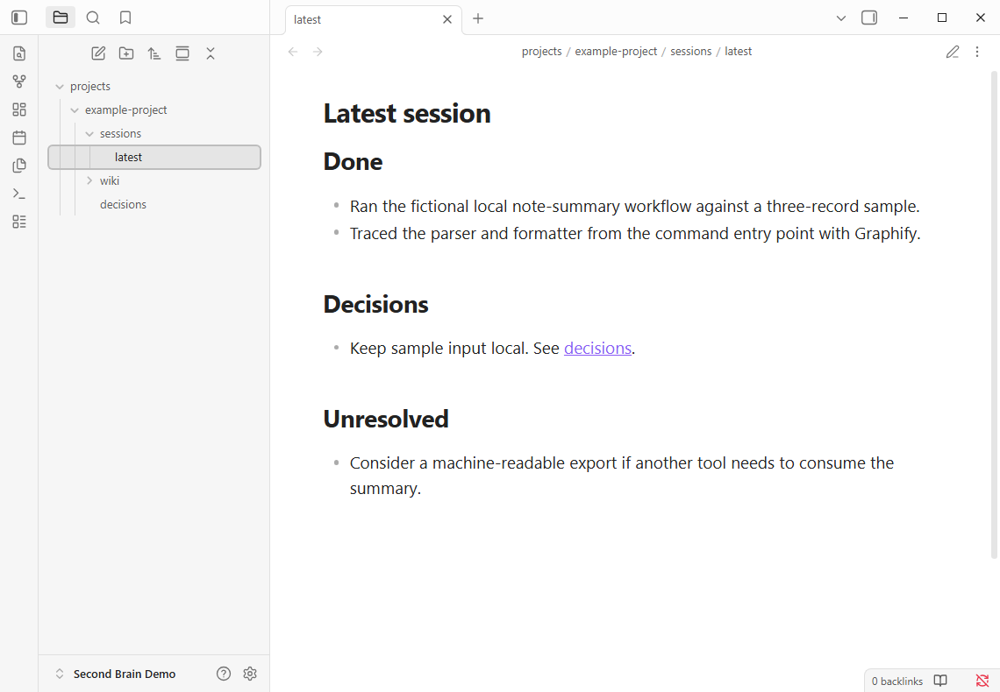
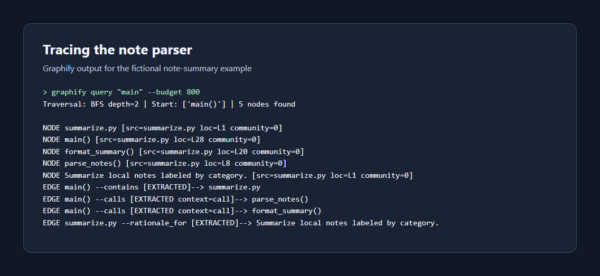
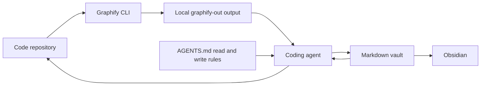

# AI Second Brain 2.0

A local Markdown vault for giving coding agents project handovers, architecture decisions, and a queryable code graph.

## Demo





The screenshots use the included fictional vault and [example code](examples/note-summary/). Obsidian displays Markdown from the vault. Graphify indexes the example's Python files locally. The capture uses no provider credentials or API calls.

## What it does

Coding agents can lose the reasoning behind earlier changes between sessions. This vault gives them a read order for the latest handover, decisions, and relevant wiki pages, plus a way to query a code graph when one exists. The public template demonstrates the project handover workflow from the broader Second Brain design with fictional notes.

## Workflow and architecture



Markdown holds handovers and decisions. Obsidian gives people a way to browse that record. Graphify supplies source locations and code relationships to check against the notes.

## Prerequisites and quick start

- [Obsidian](https://obsidian.md/) to browse and edit the vault. Any Markdown editor works.
- Python 3.10+ to run the example code.
- Optional [uv](https://docs.astral.sh/uv/) to install [Graphify](https://github.com/graphify-labs/graphify).

Open this folder in **Obsidian → Open folder as vault**, then read the fictional [handover](projects/example-project/sessions/latest.md), [decision](projects/example-project/decisions.md), and [architecture note](projects/example-project/wiki/architecture.md). For a Codex session, start with [AGENTS.md](AGENTS.md). Copy the [note templates](templates/) into a private vault for real work.

Run the fictional example from this repository's root:

```sh
cd examples/note-summary
python summarize.py sample.txt
```

To rebuild and query the graph, run these commands from the same example folder:

```sh
uv tool install graphifyy
graphify update .
graphify query "main" --budget 800
```

`graphifyy` is the package name and `graphify` is the command. Code-only graph generation writes to `graphify-out/` and needs no API key. For a real project, run the graph commands from its source repository and point the coding agent to that graph.

## Configuration

The vault and example require no environment variables. Real project notes, local application state, and generated graph output are ignored by Git.

## Failure handling

The example CLI reports unreadable input and malformed records. The vault's [agent instructions](AGENTS.md) direct agents to check current source when notes or graph results are incomplete or stale. A session can begin with notes and source before a graph exists.

## Key decisions and tradeoffs

- Read the latest handover and decision log before relevant wiki pages. This gives an agent recent context and recorded reasoning before broader reference material.
- Query a specific symbol or module to keep graph lookups focused on the current task. The code graph stays with the source where it can be regenerated.
- Use plain Markdown so people can browse in Obsidian while agents use the files directly. The 2.0 design extends this with a short routing map and indexed domains for larger vaults. Maintaining accurate notes still requires checking them against source and updating them after work.

## How this was built

I set the requirement that a new coding-agent session should recover recent work and the reasoning behind decisions from a small number of files. I chose a shared Markdown vault, optional Obsidian navigation, and a Graphify index kept with the source code. I defined the read order and the expectation that agents check handovers against current source. For this public release, I specified fictional data and Codex for AI-assisted demo preparation and verification. Codex ran the example, built and queried the code graph, and reviewed the captured images.

## Scope

- The public template covers the local vault, handover, and code graph workflow. The broader design includes scheduled ingestion, operational dashboards, and role-based access as deployment work.
- The CLI and notes describe a small, fictional project. Keeping a real vault current requires a handover after each session and regular checks against the source.
